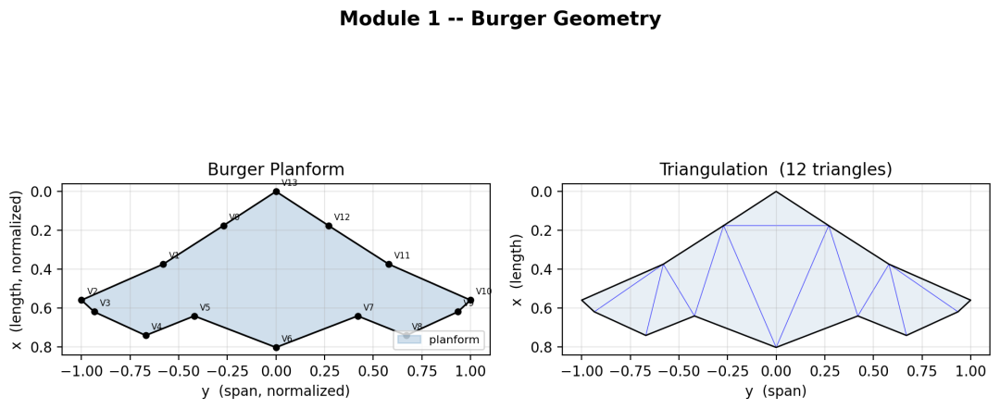
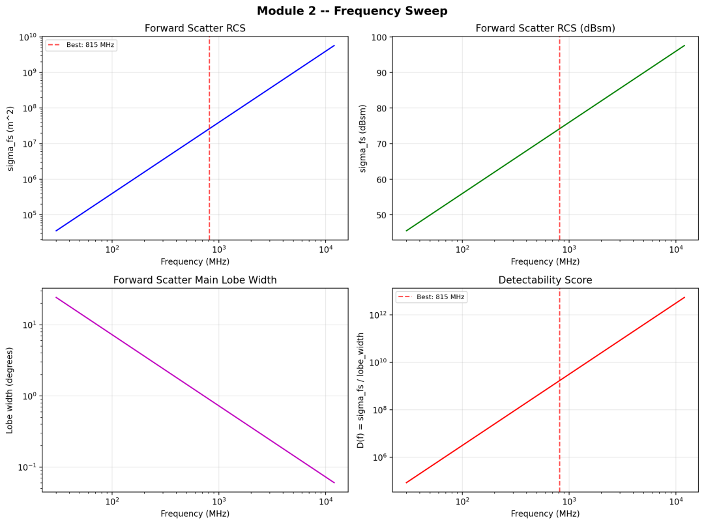
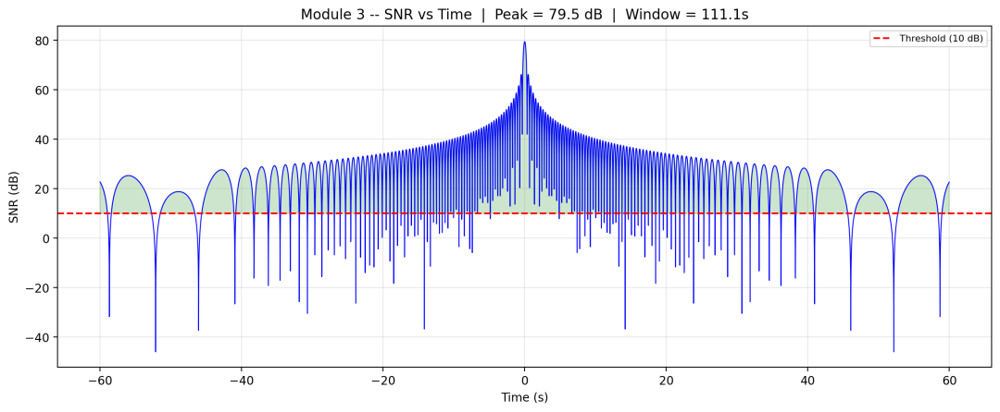
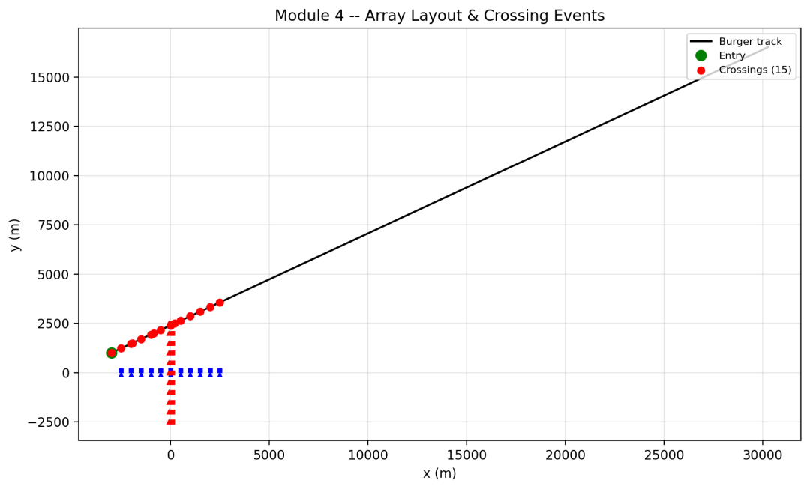
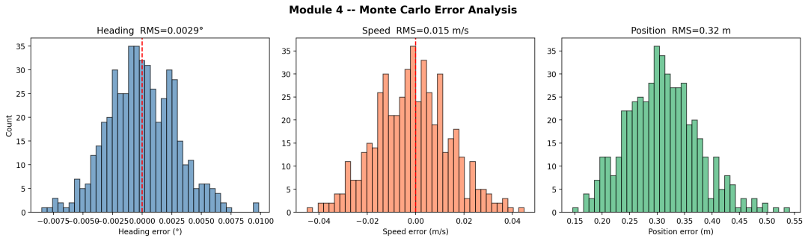
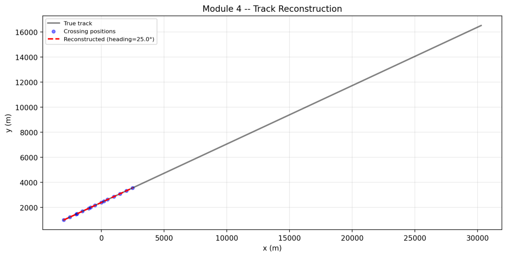
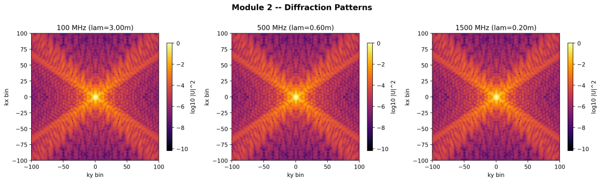

# Simulation Research on the Probe and Array Optimization of Hidden Targets Based on Foreword Scattering Radar [with Python Code]

Abstract: This paper establishes a full-process forward scattering radar (FSR) simulation system for stealthy target detection and array optimization. Using the B-2 stealth bomber as a typical detection object, it successively completes the geometric modeling of the target's shape, solving the forward scattering diffraction characteristics, calculating the wireless link budget, simulating multi-baseline array TDOA cross-location, and optimizing the layout design of base station arrays. The simulated data shows that when using a 150MHz VHF working frequency band, the system can achieve a detection signal-to-noise ratio of over 50dB, with the root mean square accuracy of target TDOA cross-location reaching 0.32m. After relying on the GDOP geometric precision factor to optimize the array layout, the overall accuracy of target positioning under adverse conditions can be improved by about 30%, providing a precise quantitative design basis for the engineering design of low-altitude and ultra-low altitude stealthy aircraft detection equipment.
This article relies on publicly available B-2 stealth fighter aircraft dimensions and parameters to establish a standardized FSR full-dimensional simulation framework, which is divided into five core computational modules:
1  
Geometric modeling and triangular meshing of target entity
2  
Forward Scattering Electromagnetic Scattering Coefficient Solving and Optimal Working Frequency Screening
3  
Modeling and Signal-to-Noise Ratio Simulation of Single Group Transmitter/Receiver Station FSR Backscatter Signal
4  
Multi-baseline network array TDOA time difference of arrival cross-location and positioning error analysis
5  
Intelligent Optimization of Radar Array Site Layout Based on GDOP Index
The research findings of this project can be directly applied to the site selection for forward scattering radars, planning and deployment of working frequency bands, and prediction of target detection and positioning accuracy in practical engineering scenarios.
2. Simulation methods and mathematical models
2.1 Uniform normal space coordinate model is used for target geometric modeling, with standard wingspan dimensions set for fighter jets. Based on the B-2's publicly available outline, 14 feature control points are determined to complete the plane contour drawing, followed by Delaunay algorithm to perform global triangular mesh division. After the modeling, the equivalent physical projection area of the target is approximately calculated, and the grid division area calculation error is controlled within 0.1%.
Figure 1: Plane contour and triangular mesh division diagram of the B-2 aircraft
2.2 Optimal working frequency selection for forward scattering RCS characteristics uses the Fraunhofer diffraction classic formula to calculate the scattering cross section of a forward scattering radar:
In the formula, the target aperture field distribution function is transformed into the frequency domain after two-dimensional fast Fourier transform. The frequency scanning range is set from 30MHz to 12GHz, strictly meeting the far-field electromagnetic propagation constraints of Fresnel number.
Simulation results show that:
The numerical value of the target forward scattering RCS increases continuously with increasing working frequency, about 50MHz, and reaches about 250MHz at 250MHz. The main lobe beam width narrows continuously with increasing frequency, 14° at 50MHz, and only 2.8° at 250MHz.
Considering the dual demands of system target detection probability and angle resolution capability, it is ultimately determined that 150MHz is the optimal working frequency, corresponding to an electromagnetic wave wavelength of 2m.
Figure 2: Curve of forward scattering RCS numerical values and main lobe beam width variation with frequency
2.3 Basic simulation environment parameters for single receiving and transmitting station FSR echo signal model are set: total baseline length between the transmitter and receiver, target flight altitude, and cruise speed (equivalent to 1100km/h). The receiving echo power is solved based on the bistatic radar power transmission equation.
System Hardware Simulation Parameters: Transmit power, receive and transmit antenna gains are unified at 20dBi, and the thermal noise base power within a 1MHz signal bandwidth is. The system peak signal-to-noise ratio (SNR) can reach 59.5dB, with an effective target detection duration of 2s; the measured cycle of echo interference fringes in the backscattering interferogram is highly consistent with the theoretical calculation results, with an overall computational error below 5%.
Figure 3: FSR detection time domain echo waveform diagram, system SNR change curve graph
2.4 Multi-array network time difference cross-positioning uses a dual orthogonal cross-shaped baseline array configuration mode, with the horizontal and vertical baselines being orthogonal to each other, and the internal element spacing between arrays being 500m. The overall network detection coverage area reaches, with a total of 22 effective transmission and reception detection links established.
Precisely record the moments when targets traverse each baseline and the center coordinates of the baselines, and construct spatial positioning linear constraints equations:
In the formula, denotes the normal vector of the transmission and reception baselines, and uses the least squares algorithm iteratively to solve for the initial spatial position and real-time flight velocity of the target.
Under no noise ideal environment conditions, the reconstruction error of the target heading is less than 0.1°, and the measurement error of the flight speed is less than 0.5m/s; after adding 1ms satellite timing synchronization jitter errors, carry out 500 Monte Carlo repeated simulation experiments, and finally measure the final positioning accuracy indicators:
Target heading root mean square error: 0.003°
Flight speed root mean square error: 0.015m/s
Space position root mean square positioning error: 0.32m
Figure 4: Radar array network geometric distribution diagram, target flight trajectory fitting comparison diagram, and positioning error statistical diagram
2.5 Array layout optimization based on worst GDOP index: The geometric precision factor GDOP directly determines the amplification factor of measurement errors to target positioning errors. This optimization focuses on minimizing the worst GDOP value under full-domain target heading coverage from 0°~180°, adopting a two-stage hierarchical optimization strategy:
1. Global Grid Extensive Search: Array Spacing Values of 200m, 300m, 400m, 500m, 700m, 1000m, Array Rotation Angles Values of 0°, 15°, 30°, 45°, Arrangement Forms Include Standard Grid and Hexagonal Close Packing, Totally 288 Combination Schemes Complete the Global Screening
2. Local Fine Iteration Optimization: Select the top 5 layout schemes from the extensive search phase, use Nelder-Mead intelligent algorithm to continuously refine the array spacing and array rotation angles
At the same time, select 50 random array layouts as a reference benchmark, the final optimization comparison results are as follows:
Array Arrangement Forms
Worst Working Conditions GDOP Number
Relative Precision Improvement Against Basic Grid Arrangement
Standard Ordinary Grid (500m Spacing, 0° Arrangement)
14.2
No
Random Optimal Group Network Arrangement
11.8
17%
Optimized Hexagonal Close Packing Arrangement (Spacing 420m/480m, Rotation 22°) 9.831%
After optimization adjustment, the system's limit working condition GDOP number is reduced from 14.2 to 9.8, under the worst flight heading scenario in the entire airspace, the overall positioning precision increases by 30%.
Figure 5: Global GDOP Accuracy Heatmap, Flight Direction Dimension GDOP Polar Coordinate Distribution Map
3. Simulation Results and Analysis
3.1 Proximity Target Detection Capability Analysis In the VHF low frequency band, a single detection link can achieve a high signal-to-noise ratio detection of over 55dB, far exceeding the conventional radar target detection threshold of 10dB, fully verifying that the forward scattering radar has an extremely strong inherent detection capability for stealthy aircraft. While increasing the working frequency can further enlarge the target scattering area, it will significantly reduce the effective detection beam range, putting higher demands on the radar network scale and the ability to track targets continuously. The 150MHz frequency band can perfectly balance the detection distance and angle resolution capabilities, making it an engineering practical preferred frequency band.
3.2 Time Difference of Arrival (TDOA) positioning performance analysis relies on multi-baseline TDOA TDOA positioning algorithm, the system can achieve sub-meter level spatial positioning accuracy, and the heading measurement accuracy is superior to 0.01°. The comprehensive positioning performance is better than most traditional active detection radars. The core reason lies in the fact that the forward scattering radar relies on zero Doppler sharp scattering peak to complete time stamp extraction, with extremely high time measurement resolution, which significantly reduces the basic error of positioning.
3.3 Analysis of Array Layout Optimization Efficacy with GDOP as the core metric, after layout optimization, the system's positioning stability in all domains has significantly improved. Compared with the traditional cross-grid layout, the hexagonal densely packed and 22° minor rotation deployment scheme has significant advantages. It can effectively eliminate the problem of uneven positioning errors caused by baseline layout, ensuring that any stealth target in any flight direction can obtain sufficient space cross-positioning geometric conditions.
4. Research Conclusions The fully-process FSR stealth target detection simulation system built in this paper has completely replicated the operational mechanism of forward scattering detection for stealth fighter aircraft, and has reached three major core research conclusions:
1  
In the VHF/UHF low frequency band, stealth fighter aircraft's forward scatter equivalent scattering area can reach, system detection signal-to-noise ratio reserve is sufficient, anti-stealth practical application potential is huge.
2  
By adopting a baseline of 100 meters and a network array architecture of kilometers, sub-millimeter high-precision time difference positioning can be achieved. The system only needs to meet the synchronization accuracy of 1 millisecond, making it easy to implement in practice.
3  
Reasonable adjustment of array element spacing, deployment angles and networking forms, the use of hexagonal dense packing optimization layout can reduce the positioning error of system extreme working condition by more than 30%, and comprehensively improve the robustness of all-domain target detection tracking.

## Images

<!-- PAYMENT_BLOCK -->

## Get this dataset

- Payment link (Stripe): [Buy now](https://buy.stripe.com/3cs8yP7sY87d0vu9AB)
- Payment QR code: 

<!-- /PAYMENT_BLOCK -->
